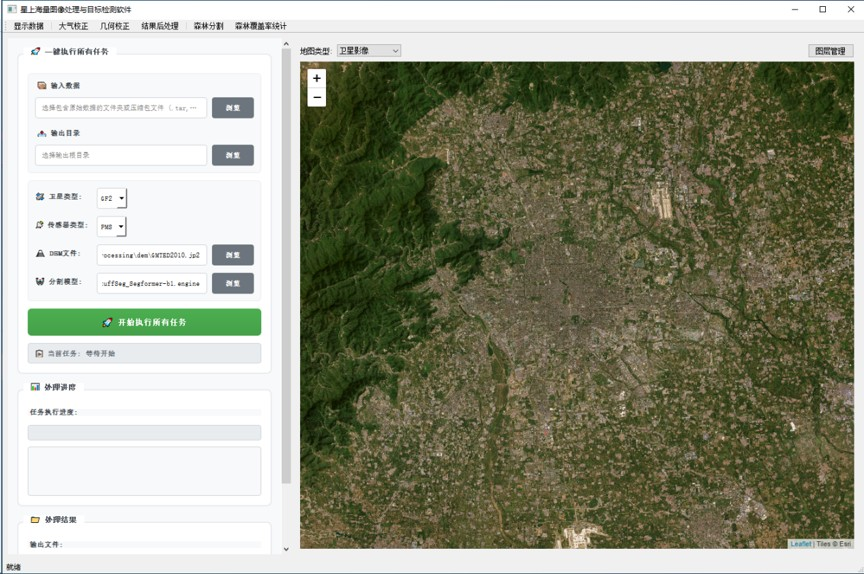
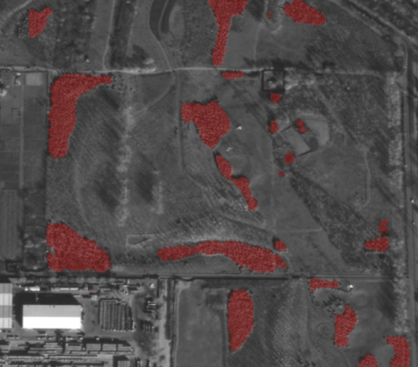

# 遥感森林分割软件研制

实习期间参与一套面向国产高分辨率遥感影像的桌面处理软件研制，负责森林语义分割链路的工程落地：在 Linux 与 Windows 上部署软件并用 Conda 配置环境，接入 TensorRT 推理加速，压缩送入模型前的影像预处理耗时，并承担软件 bug 修复与研制报告撰写。

## 项目背景

软件面向高分辨率卫星影像的森林识别与定量统计，把「原始影像 → 几何校正 → 森林分割 → 覆盖率统计」组织为可批量执行的业务流程。分割模型与算法由团队提供，本人的工作集中在部署、提速与软件稳定性这条工程链路上。

森林识别在这里被定义为森林与非森林的像素级语义分割，而不是目标检测框：森林是连续面状地物，边界不规则、内部结构复杂，检测框会不可避免地包含道路、裸地与阴影，无法直接支撑覆盖面积和覆盖率计算，只有像素级掩膜才能给出可量算的空间边界。

## 我的工作

- 跨平台部署与环境配置：在 Linux 与 Windows 两套平台上完成森林分割软件的部署。用 Conda 建立独立环境并固定依赖版本，逐一处理两个系统在运行库、编译器与图形界面依赖上的差异，使同一套环境在两端都能复现，避免换一台机器就跑不起来。
- TensorRT 推理加速部署：把分割模型接入 TensorRT 推理链路并部署到目标机器，核对加速前后的输入输出尺寸与分割结果一致性，确保提速不以精度为代价。
- 模型输入的预处理提速：SegFormer 对输入的通道数与数值范围有固定要求，而原始影像幅面大、为单通道且含无效值。围绕「把影像整理成模型可接受的输入」这一环节重构处理流程，缩短预处理耗时，避免它成为整条链路的瓶颈。
- bug 修复与报告撰写：定位并修复软件在数据处理、界面交互与推理调用中的多类问题；把研制过程与交付情况整理成研究报告，作为项目交付文档。

## 工程落地

- 交付的目标不是「某一次推理能出结果」，而是这条链路在目标机器上能稳定、可重复地跑完，环境配置与部署方式本身就是交付物。
- 环境用 Conda 隔离并锁定依赖版本：依赖能装、能复现，才算部署完成。
- 推理侧用 TensorRT 加速，并核对加速前后的输入输出尺寸与分割结果一致性，保证精度不因加速而下降。
- 模型对输入通道有固定要求，原始全色影像是单通道，部署时通过一层包装适配为模型可接受的输入形式。
- 大幅面影像按固定尺寸图块切分后分批推理，再拼接回完整区域掩膜，避免一次性载入整景影像带来的内存压力。
- 森林覆盖率按「森林像素数 ÷ ROI 有效像素数」统计，并在图块拼接与范围裁剪之后保持统计口径一致。

## 结果

软件形成了从影像读取、预处理、模型推理到覆盖率输出的完整闭环，可在 Linux 与 Windows 上完成批量森林分割任务，输出栅格掩膜与统计数据供人工复核。部署侧交付了可复现的 Conda 环境配置与 TensorRT 推理链路，配合 bug 修复与研制报告，把模型从「能跑通」推进到「可交付」。

## 图示

