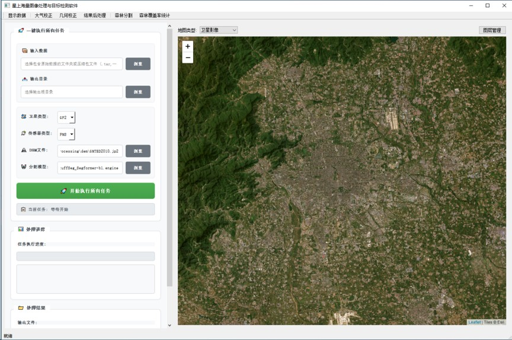
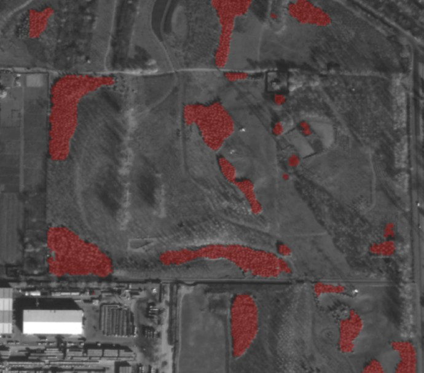

# 遥感森林分割软件研制

实习期间参与遥感森林分割桌面软件的研制。我负责 Linux 和 Windows 平台的部署与环境配置、TensorRT 推理加速、影像预处理提速，以及 bug 修复和研制报告撰写。

## 项目背景

软件处理国产高分辨率卫星影像，依次完成几何校正、森林分割和覆盖率统计，并支持批量处理。分割模型与算法由团队提供，我的工作主要集中在部署和软件优化。

软件采用像素级语义分割来区分森林与非森林。森林边界不规则，检测框容易包含道路、裸地和阴影；像素级掩膜则可以提供用于计算覆盖面积和覆盖率的空间边界。

## 我的工作

- 在 Linux 和 Windows 上部署软件，使用 Conda 配置独立环境并固定依赖版本，处理运行库、编译器和图形界面依赖的跨平台差异。
- 将分割模型接入 TensorRT 推理链路，部署到目标机器，并核对加速前后的输入输出尺寸和分割结果。
- 针对 SegFormer 的输入要求，调整大幅面单通道影像及无效值的预处理流程，缩短处理耗时。
- 修复数据处理、界面交互和推理调用中的问题，并撰写研制报告。

## 实现与结果

部署时，通过包装适配模型输入通道。大幅面影像按固定尺寸切分、分批推理，再拼接成完整区域掩膜，以减少内存压力。森林覆盖率按森林像素数与 ROI 有效像素数之比统计，图块拼接和范围裁剪后保持统计口径一致。

软件支持在 Linux 和 Windows 上批量完成影像读取、预处理、模型推理和覆盖率统计，输出栅格掩膜与统计数据供人工复核。交付内容包括 Conda 环境配置、TensorRT 推理链路和研制报告。

## 图示

