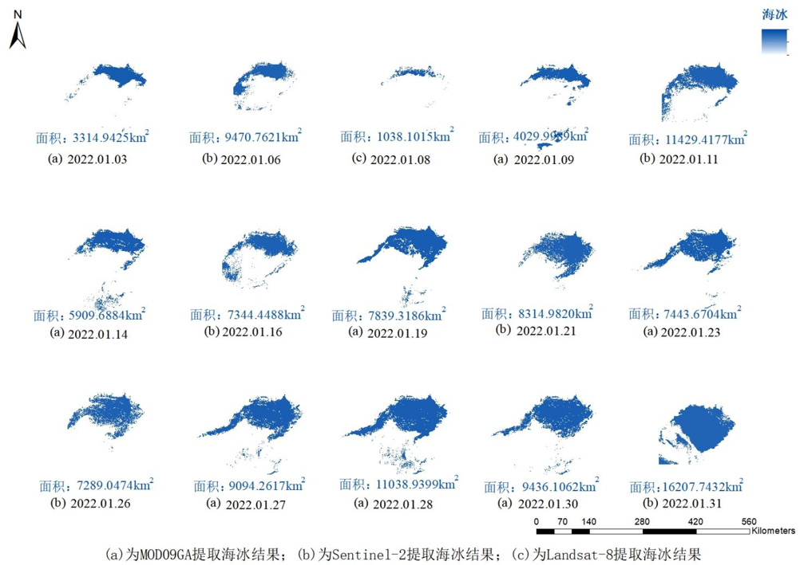
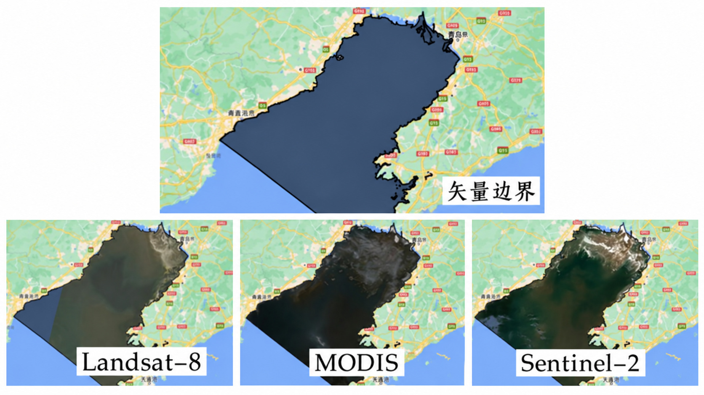

# 辽东湾海冰监测与预警

围绕辽东湾冬季冰情，利用多源遥感提取海冰分布与面积，分析冰情和气温的关系，为港口、航道与海洋工程的风险防范提供信息。

## 项目目标

辽东湾冬季海冰影响航运、养殖和海上设施。在研究区域的矢量边界内，结合 Landsat-8、MODIS 与 Sentinel-2 影像研究海冰分布与面积，并探索气象因子驱动的预警方法。

## 我的工作

- 负责海冰提取算法构建和代码编写，在 GEE 中批量调用 Sentinel-2 影像，开展 2015—2022 年海冰监测。
- 结合海冰与海水的光谱差异，引入 Otsu 自动阈值分割，完成海冰识别、面积统计与结果输出。
- 将算法流程整理为《辽东湾海冰监测系统》，该软件著作权已获得授权。

## 案例与成果

2022 年 1 月案例展示 MOD09GA、Sentinel-2 与 Landsat-8 的多时相海冰提取结果和面积统计，呈现海冰分布随时间的变化。

项目完成了遥感监测算法与软件成果积累。预测因子选择、权重确定和海冰预警模型属于申报与答辩材料中的拓展研究目标。

## 图示

