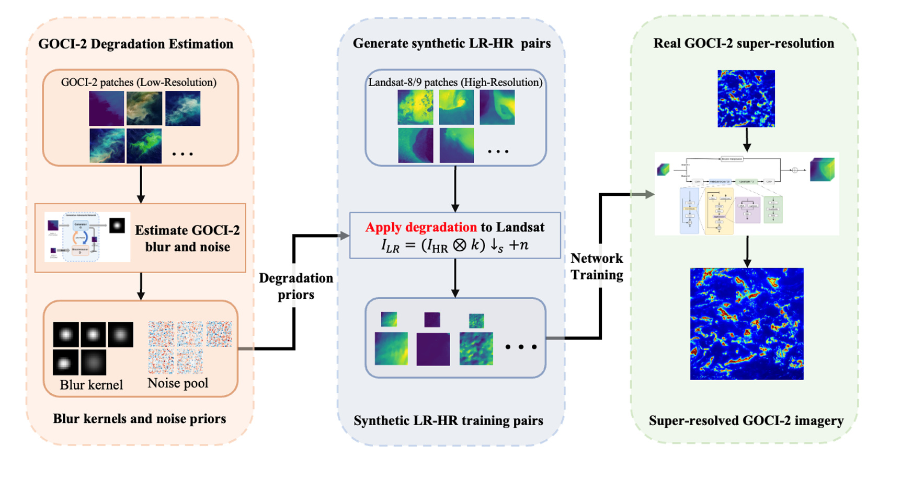
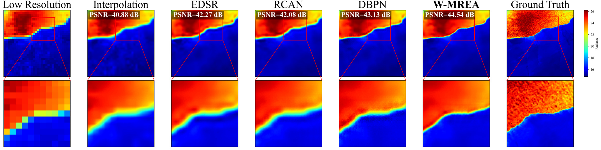
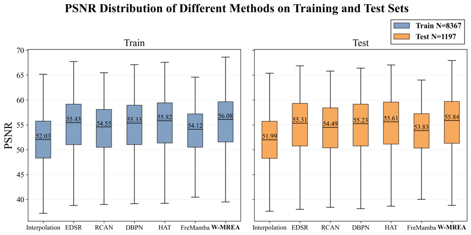
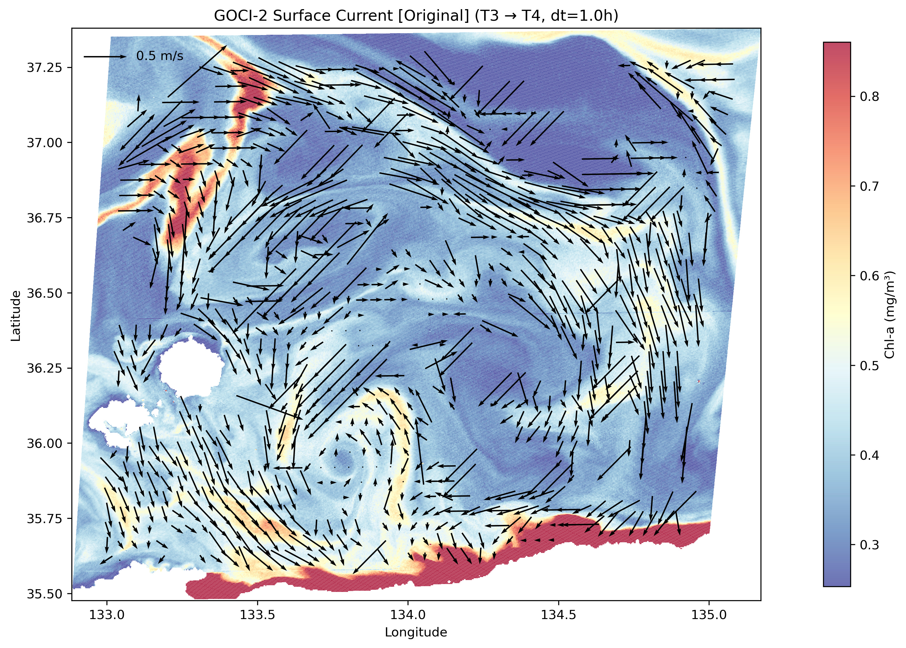
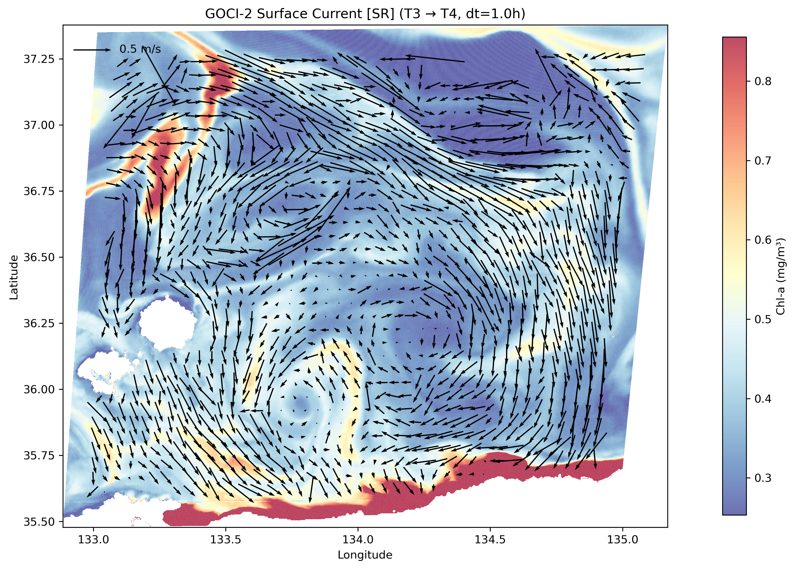

# 水色遥感影像超分辨率

面向高时间分辨率、弱纹理的水色遥感影像，学习真实成像退化，在恢复空间细节的同时验证水色反演与海流分析的可用性。

## 研究目标

GOCI-2 提供小时级观测，但 250 m 空间分辨率限制了锋面、藻华和小尺度海流的识别。研究以 Landsat-8/9 为高分辨率参考，开展 8 倍重建，并关注光谱关系的保持。

## 我的工作

- 构建包含真实模糊核和噪声的退化池，生成 11,954 个样本，按 7:2:1 划分训练、验证与测试集。
- 设计 W-MREA 水体多尺度残差边缘注意力网络，结合 MAE 与光谱角损失，对比 EDSR、RCAN、DBPN、HAT 和 FreMamba。
- 将重建影像用于 NDVI/Otsu 浒苔提取、Chl-a 反演，以及基于最大互相关（MCC）的海表流场分析。

## 结果与进展

独立测试集平均 PSNR 为 55.84 dB，高于 HAT 的 55.61 dB。锋面边界与平滑水体的弱纹理恢复更清晰；多景浒苔实验中面积结果更接近 Landsat 参考，但仍存在高估。

日本海案例中，基于间隔 1 h 的两时相影像，分别提取原始与超分辨率影像的 MCC 海表流场。并排结果显示局部流向转折更连续，Chl-a 统计分布总体保持；与 CMEMS 的对比仍属定性验证。

## 图示

### 海表流场对比（T3—T4，间隔 1 h）

