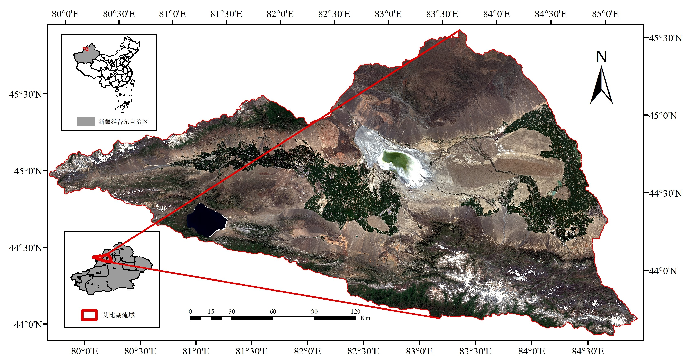
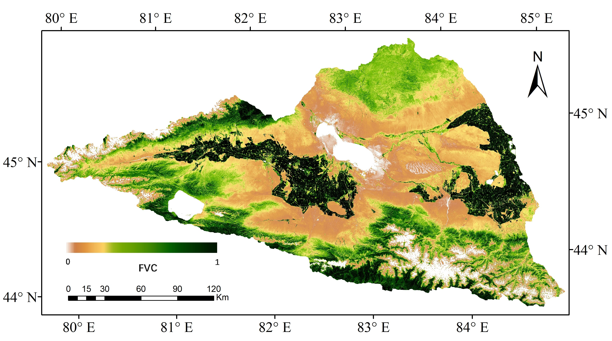
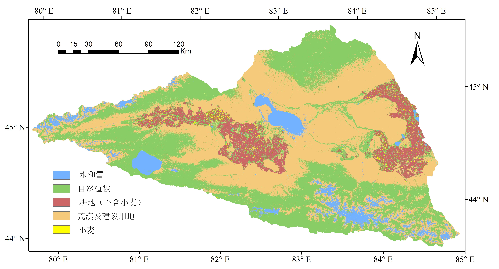
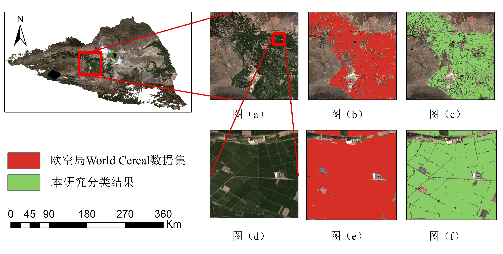

# 艾比湖流域植被覆盖度

以新疆艾比湖流域为研究区，依托 Google Earth Engine 生成植被覆盖度数据，结合物候、地形与纹理识别自然植被和耕地。

## 研究目标

研究区涵盖艾比湖、赛里木湖及周边山地、绿洲和荒漠。针对自然植被与人工耕地交错分布的特点，分析 2013—2023 年植被覆盖度变化，提取耕地并刻画其空间分布。

## 我的工作

- 使用 GEE Python API 处理 1,712 景 Landsat-8 影像，通过 NDVI 和像元二分模型生成 88 个月的植被覆盖度数据。
- 采用年度合成与 Sen 中值斜率分析长期变化，利用月度差值突出自然植被、耕地与小麦的物候差异。
- 融合 FVC、DEM、坡度及 GLCM 纹理特征，构建五类随机森林分类器；分层抽取 5,000 个样本，以 7:3 划分训练和验证数据。

## 主要结果

FVC 空间图以 0—1 连续色标呈现覆盖度差异：绿洲耕地覆盖度较高，山区分布自然植被，荒漠区覆盖度较低。

五类分类区分水域与冰雪、自然植被、非小麦耕地、荒漠与建筑、小麦；局部结果与原始影像、WorldCereal 对照。2023 年总体精度按论文报告为 96%，Kappa 为 0.96。

## 图示

